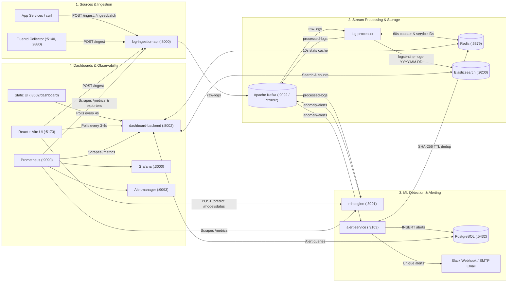
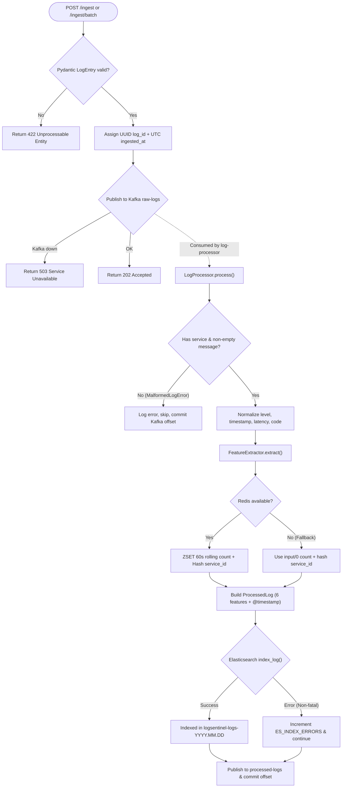
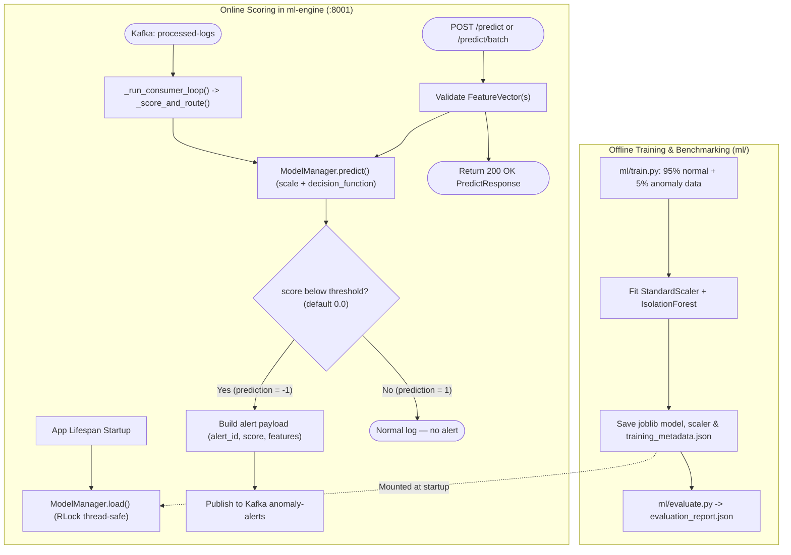
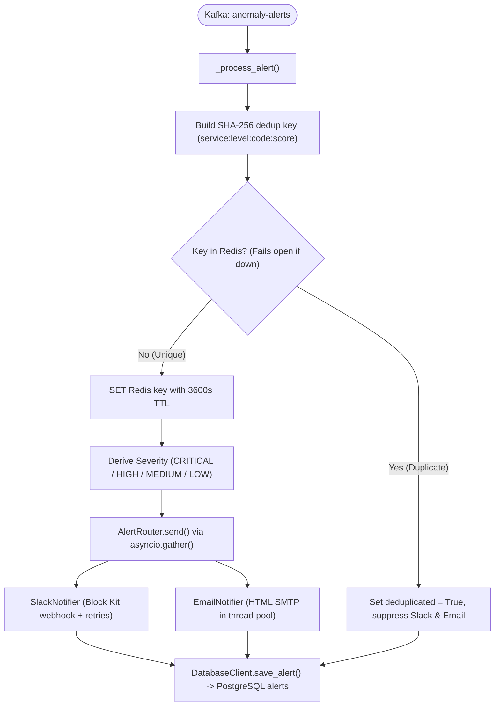
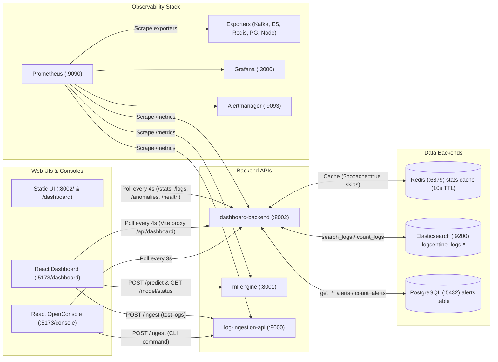

# LogSentinel — Architecture, Data Flow & Codebase Guide

LogSentinel is a microservices-based AI log observability platform. It ingests application logs over HTTP, streams events through Apache Kafka, extracts 6 real-time behavioral features using Redis, indexes searchable logs in Elasticsearch, detects anomalies with a scikit-learn `IsolationForest` model, deduplicates and routes alerts to Slack, Email, and PostgreSQL, and serves live telemetry to two web dashboards plus Prometheus and Grafana.

## Table of Contents

- [1. High-Level System Architecture](#1-high-level-system-architecture)
- [2. Services, Topics & Data Stores](#2-services-topics--data-stores)
- [3. Stage-by-Stage Flowcharts](#3-stage-by-stage-flowcharts)
  - [3.1 Ingestion, Normalization & Feature Engineering](#31-ingestion-normalization--feature-engineering)
  - [3.2 ML Training & Anomaly Scoring](#32-ml-training--anomaly-scoring)
  - [3.3 Alert Deduplication, Routing & Persistence](#33-alert-deduplication-routing--persistence)
  - [3.4 Query API, Live UIs & Monitoring](#34-query-api-live-uis--monitoring)
- [4. Codebase Reference by Module](#4-codebase-reference-by-module)
  - [Root & Orchestration](#root--orchestration)
  - [Module 1: Log Ingestion API](#module-1-log-ingestion-api-serviceslog-ingestion-api)
  - [Module 2: Log Processor](#module-2-log-processor-serviceslog-processor)
  - [Module 3: ML Training & Engine](#module-3-ml-training--engine-ml--servicesml-engine)
  - [Module 4: Alert Service](#module-4-alert-service-servicesalert-service)
  - [Module 5: Dashboard Backend & Built-In UI](#module-5-dashboard-backend--built-in-ui-servicesdashboard-backend)
  - [Module 6: React + Vite SPA Frontend](#module-6-react--vite-spa-frontend-servicesdashboard-frontend)
  - [Pipeline, Monitoring, Infra & Tests](#pipeline-monitoring-infra--tests)

---

## 1. High-Level System Architecture

---

## 2. Services, Topics & Data Stores

### Application Services & UIs

| Service | Port | Consumes / Reads | Produces / Writes | Role |
| --- | --- | --- | --- | --- |
| `log-ingestion-api` | `8000` | HTTP JSON logs | Kafka `raw-logs` | Validates incoming logs and assigns `log_id` + `ingested_at`. |
| `log-processor` | — | Kafka `raw-logs`, Redis | Elasticsearch, Kafka `processed-logs` | Normalizes fields, extracts 6 ML features, and indexes logs. |
| `ml-engine` | `8001` | Kafka `processed-logs`, HTTP `/predict` | Kafka `anomaly-alerts`, HTTP JSON | Scores 6-feature vectors via `IsolationForest` + `StandardScaler`. |
| `alert-service` | `9103` (metrics) | Kafka `anomaly-alerts`, Redis | PostgreSQL `alerts`, Slack / Email | Deduplicates alert bursts, routes notifications, and persists history. |
| `dashboard-backend` | `8002` | Elasticsearch, PostgreSQL, Redis | HTTP JSON & Static HTML | Serves query REST endpoints (`/logs`, `/anomalies`, `/stats`) and built-in UI. |
| `dashboard-frontend` | `5173` (dev) | `dashboard-backend`, `ml-engine`, `log-ingestion-api` | Browser UI | React + Vite SPA with Operations Dashboard, Open Console, and API Docs. |
| `log-collector` | `5140`, `9880` | Docker logs, Syslog, HTTP | `log-ingestion-api` | Fluentd forwarder normalizing container and syslog streams. |

### Kafka Topics (Local Docker Compose)

| Topic | Partitions | Producer | Consumer | Payload Summary |
| --- | --- | --- | --- | --- |
| `raw-logs` | `3` | `log-ingestion-api` | `log-processor` | Validated log payload + `log_id` + `ingested_at`. |
| `processed-logs` | `3` | `log-processor` | `ml-engine` | Normalized log + `@timestamp` + `processed_at` + 6-dim `features` dict. |
| `anomaly-alerts` | `1` | `ml-engine` | `alert-service` | Alert metadata (`alert_id`, `detected_at`, `anomaly_score`, `prediction`, `features`). |

### Data Stores & Key Patterns

| Store | Port | Purpose | Key / Index / Table Pattern |
| --- | --- | --- | --- |
| **Redis** | `6379` | Sliding-window rate counter | `logsentinel:rolling:<service>` (Sorted Set, 60s window) |
| **Redis** | `6379` | Service label encoder | `logsentinel:service_id_map` (Hash) & `logsentinel:service_id_counter` |
| **Redis** | `6379` | Alert storm deduplication | `logsentinel:alert:dedup:<sha256_16>` (TTL `3600s` default) |
| **Redis** | `6379` | Dashboard stats cache | `stats:<window_minutes>` (JSON string, TTL `10s` default) |
| **Elasticsearch** | `9200` | Searchable log documents | Daily indices `logsentinel-logs-YYYY.MM.DD` (template `logsentinel-logs-*`) |
| **PostgreSQL** | `5432` | Persistent anomaly alerts | Table `alerts` (`alert_id`, `log_id`, `anomaly_score`, `deduplicated`, `features`, etc.) |

---

## 3. Stage-by-Stage Flowcharts

### 3.1 Ingestion, Normalization & Feature Engineering

**Extracted 6-Dimensional Feature Vector** (canonical order shared between training, processor, and inference):

| # | Feature | Range / Encoding | Fallback When Missing / Redis Down |
| --- | --- | --- | --- |
| 1 | `hour_of_day` | `0–23` (UTC hour parsed from `timestamp`) | Current UTC hour |
| 2 | `response_time_ms` | Float `>= 0.0` (capped at `300,000.0` in ML schema) | `0.0` |
| 3 | `error_code` | Bucket `0`=none, `1`=2xx, `2`=3xx, `3`=4xx, `4`=5xx, `5`=other | `0` |
| 4 | `log_level_encoded` | `DEBUG=0`, `INFO=1`, `WARN=2`, `ERROR=3`, `CRITICAL=4` | `1` (`INFO`) |
| 5 | `request_count_last_60s` | Count from Redis sorted set `logsentinel:rolling:<service>` | Input field or `0` |
| 6 | `service_id_encoded` | Persistent integer ID from Redis hash `logsentinel:service_id_map` | `abs(hash(service)) % 10000` |

---

### 3.2 ML Training & Anomaly Scoring

- **Thread safety & hot reload**: `ModelManager` wraps the loaded model and scaler with a `threading.RLock` so `reload()` can swap artifacts safely while synchronous and background predictions finish cleanly.
- **Readiness gate**: `GET /health` returns `503` if the model is not loaded or Kafka consumer/producer clients are disconnected.

---

### 3.3 Alert Deduplication, Routing & Persistence

**Severity Mapping (`_severity_from_alert`)**:

| Severity | Condition |
| --- | --- |
| `CRITICAL` | `anomaly_score < -0.3` **and** `level` is `CRITICAL` or `ERROR` |
| `HIGH` | `anomaly_score < -0.2` **or** `level == ERROR` |
| `MEDIUM` | `anomaly_score < -0.1` |
| `LOW` | All other anomalies |

> **Fail-open resilience:** If Redis is unreachable, `AlertDeduplicator.is_duplicate()` returns `False` so genuine incidents are never silently dropped during a cache outage. Both unique and deduplicated alerts are always recorded in PostgreSQL.

---

### 3.4 Query API, Live UIs & Monitoring

---

## 4. Codebase Reference by Module

### Root & Orchestration

| File | Responsibility |
| --- | --- |
| [`docker-compose.yml`](file:///c:/Users/sanid/OneDrive/Desktop/prog/logsentinel-main/logsentinel-main/docker-compose.yml) | Runs full local stack: Zookeeper, Kafka (`9092`/`29092`), `kafka-init`, Kafka UI (`8090`), Elasticsearch (`9200`), PostgreSQL (`5432`), Redis (`6379`), all 5 microservices, Prometheus (`9090`), Alertmanager (`9093`), Grafana (`3000`), and `kafka-exporter` (`9308`). |
| [`Makefile`](file:///c:/Users/sanid/OneDrive/Desktop/prog/logsentinel-main/logsentinel-main/Makefile) | Developer shortcuts for building images, running Docker Compose, training ML models, and running tests. |
| [`init.sql`](file:///c:/Users/sanid/OneDrive/Desktop/prog/logsentinel-main/logsentinel-main/infra/postgres/init.sql) | Canonical PostgreSQL DDL defining the `alerts` table and indexes (`infra/postgres/init.sql`). |
| [`vercel.json`](file:///c:/Users/sanid/OneDrive/Desktop/prog/logsentinel-main/logsentinel-main/vercel.json) | Configures static deployment build from `services/dashboard-frontend` (`vite build` -> `dist`). |

---

### Module 1: Log Ingestion API (`services/log-ingestion-api/`)

FastAPI HTTP gateway on port `8000` that validates log payloads and publishes to Kafka `raw-logs`.

| File | Purpose | Key Symbols & Routes |
| --- | --- | --- |
| [`main.py`](file:///c:/Users/sanid/OneDrive/Desktop/prog/logsentinel-main/logsentinel-main/services/log-ingestion-api/main.py) | FastAPI app & lifecycle | `lifespan`, `metrics_middleware`, `_enrich_log_entry`, `_publish_to_kafka`, `GET /`, `GET /health`, `GET /metrics`, `POST /ingest`, `POST /ingest/batch` |
| [`models.py`](file:///c:/Users/sanid/OneDrive/Desktop/prog/logsentinel-main/logsentinel-main/services/log-ingestion-api/app/models.py) | Request/response schemas | `LogLevel`, `LogEntry` (`service_must_be_slug`, `normalise_log_level`, `parse_timestamp`), `BatchIngestRequest`, `IngestResponse`, `BatchIngestResponse` |
| [`kafka_producer.py`](file:///c:/Users/sanid/OneDrive/Desktop/prog/logsentinel-main/logsentinel-main/services/log-ingestion-api/app/kafka_producer.py) | Resilient async Kafka producer | `KafkaProducerClient` (`start`, `stop`, `send`, `send_batch`, `is_connected`), `KafkaPublishError`, `KafkaProducerNotStartedError` |
| [`config.py`](file:///c:/Users/sanid/OneDrive/Desktop/prog/logsentinel-main/logsentinel-main/services/log-ingestion-api/app/config.py) | Env settings | `Settings`, `get_settings()` |
| [`logger.py`](file:///c:/Users/sanid/OneDrive/Desktop/prog/logsentinel-main/logsentinel-main/services/log-ingestion-api/app/logger.py) | Structured JSON logging | `LogSentinelJsonFormatter`, `setup_logging`, `get_logger` |
| [`metrics.py`](file:///c:/Users/sanid/OneDrive/Desktop/prog/logsentinel-main/logsentinel-main/services/log-ingestion-api/app/metrics.py) | Prometheus metrics | `LOGS_INGESTED`, `KAFKA_PUBLISH_SUCCESS`, `KAFKA_PUBLISH_ERRORS`, `BATCH_SIZE_HISTOGRAM`, `REQUEST_COUNT`, `REQUEST_LATENCY` |

---

### Module 2: Log Processor (`services/log-processor/`)

Async Kafka worker consuming `raw-logs`, extracting 6 features via Redis, indexing to Elasticsearch, and producing `processed-logs`.

| File | Purpose | Key Symbols |
| --- | --- | --- |
| [`main.py`](file:///c:/Users/sanid/OneDrive/Desktop/prog/logsentinel-main/logsentinel-main/services/log-processor/main.py) | Worker entrypoint & loop | `run_processor`, `_process_message`, `_cleanup`, `_handle_shutdown_signal`, `main` |
| [`processor.py`](file:///c:/Users/sanid/OneDrive/Desktop/prog/logsentinel-main/logsentinel-main/services/log-processor/app/processor.py) | Log validation & normalization | `LogProcessor.process()`, `MalformedLogError`, `_normalise_level`, `_normalise_timestamp`, `_zero_feature_vector` |
| [`feature_extractor.py`](file:///c:/Users/sanid/OneDrive/Desktop/prog/logsentinel-main/logsentinel-main/services/log-processor/app/feature_extractor.py) | 6-feature vector builder | `FeatureExtractor` (`extract`, `_increment_and_count`, `_get_or_create_service_id`, `_warm_cache`), `_encode_error_code`, `_rolling_key` |
| [`elasticsearch_client.py`](file:///c:/Users/sanid/OneDrive/Desktop/prog/logsentinel-main/logsentinel-main/services/log-processor/app/elasticsearch_client.py) | Async ES indexer | `ElasticsearchClient` (`ensure_index_template`, `index_log`, `bulk_index_logs`, `search_logs`, `count_logs`) |
| [`kafka_consumer.py`](file:///c:/Users/sanid/OneDrive/Desktop/prog/logsentinel-main/logsentinel-main/services/log-processor/app/kafka_consumer.py) | Async consumer w/ manual commit | `KafkaConsumerClient` (`consume`, `start`, `stop`), `_json_deserialiser`, `KafkaConsumerNotStartedError` |
| [`kafka_producer.py`](file:///c:/Users/sanid/OneDrive/Desktop/prog/logsentinel-main/logsentinel-main/services/log-processor/app/kafka_producer.py) | Downstream Kafka producer | `KafkaProducerClient` (`send`, `send_batch`), `KafkaPublishError` |
| [`config.py`](file:///c:/Users/sanid/OneDrive/Desktop/prog/logsentinel-main/logsentinel-main/services/log-processor/app/config.py) | Worker configuration | `Settings` (`elasticsearch_url`, `is_production`), `get_settings` |
| [`logger.py`](file:///c:/Users/sanid/OneDrive/Desktop/prog/logsentinel-main/logsentinel-main/services/log-processor/app/logger.py) & [`metrics.py`](file:///c:/Users/sanid/OneDrive/Desktop/prog/logsentinel-main/logsentinel-main/services/log-processor/app/metrics.py) | Logging & metrics | `get_logger`, `LOGS_PROCESSED_TOTAL`, `LOGS_FAILED_TOTAL`, `ES_INDEX_SUCCESS`, `ES_INDEX_ERRORS`, `PROCESSING_DURATION` |

---

### Module 3: ML Training & Engine (`ml/` & `services/ml-engine/`)

Offline model training pipeline (`ml/`) and dual-mode inference service (`ml-engine` on port `8001`).

| File | Purpose | Key Symbols & Routes |
| --- | --- | --- |
| [`train.py`](file:///c:/Users/sanid/OneDrive/Desktop/prog/logsentinel-main/logsentinel-main/ml/train.py) | Offline synthetic training CLI | `generate_training_data`, `train_model`, `quick_evaluate`, `save_artifacts` -> writes `ml/models/{isolation_forest.joblib, scaler.joblib, training_metadata.json}` |
| [`evaluate.py`](file:///c:/Users/sanid/OneDrive/Desktop/prog/logsentinel-main/logsentinel-main/ml/evaluate.py) | Model evaluation benchmark | `generate_evaluation_dataset`, `load_model`, `evaluate` -> writes `ml/models/evaluation_report.json` |
| [`main.py`](file:///c:/Users/sanid/OneDrive/Desktop/prog/logsentinel-main/logsentinel-main/services/ml-engine/main.py) | FastAPI + Kafka consumer loop | `lifespan`, `_run_consumer_loop`, `_score_and_route`, `_build_anomaly_alert`, `GET /health`, `GET /model/status`, `POST /predict`, `POST /predict/batch`, `GET /metrics` |
| [`model_manager.py`](file:///c:/Users/sanid/OneDrive/Desktop/prog/logsentinel-main/logsentinel-main/services/ml-engine/app/model_manager.py) | Thread-safe model wrapper | `ModelManager` (`RLock`, `load`, `reload`, `predict`, `predict_batch`), `ModelMetadata`, `_feature_vector_to_numpy` |
| [`schemas.py`](file:///c:/Users/sanid/OneDrive/Desktop/prog/logsentinel-main/logsentinel-main/services/ml-engine/app/schemas.py) | Inference Pydantic models | `FeatureVector` (`cap_response_time`), `PredictResponse`, `BatchPredictRequest`, `BatchPredictResponse`, `ModelStatusResponse` |
| [`metrics.py`](file:///c:/Users/sanid/OneDrive/Desktop/prog/logsentinel-main/logsentinel-main/services/ml-engine/app/metrics.py) | Prometheus metrics | `ANOMALIES_DETECTED`, `INFERENCE_DURATION`, `KAFKA_PUBLISH_SUCCESS`, `KAFKA_PUBLISH_ERRORS`, `KAFKA_CONSUME_ERRORS`, `MODEL_LOADED` |

---

### Module 4: Alert Service (`services/alert-service/`)

Kafka consumer reading `anomaly-alerts`, deduplicating via Redis, routing notifications, and persisting to PostgreSQL (exposes Prometheus metrics on port `9103`).

| File | Purpose | Key Symbols |
| --- | --- | --- |
| [`main.py`](file:///c:/Users/sanid/OneDrive/Desktop/prog/logsentinel-main/logsentinel-main/services/alert-service/main.py) | Consumer pipeline & metrics server | `main`, `run_alert_service`, `_process_alert`, `_cleanup` (starts metrics HTTP server on `METRICS_PORT=9103`) |
| [`deduplicator.py`](file:///c:/Users/sanid/OneDrive/Desktop/prog/logsentinel-main/logsentinel-main/services/alert-service/app/deduplicator.py) | Redis TTL storm suppression | `_build_dedup_key`, `AlertDeduplicator` (`is_duplicate`, `mark_seen`, `clear`, `get_ttl_remaining`) |
| [`alerter.py`](file:///c:/Users/sanid/OneDrive/Desktop/prog/logsentinel-main/logsentinel-main/services/alert-service/app/alerter.py) | Routing & notification channels | `_severity_from_alert`, `BaseNotifier`, `AlertRouter`, `SlackNotifier`, `EmailNotifier` |
| [`slack_notifier.py`](file:///c:/Users/sanid/OneDrive/Desktop/prog/logsentinel-main/logsentinel-main/services/alert-service/app/notifiers/slack_notifier.py) & [`email_notifier.py`](file:///c:/Users/sanid/OneDrive/Desktop/prog/logsentinel-main/logsentinel-main/services/alert-service/app/notifiers/email_notifier.py) | Channel package re-exports | Re-export `SlackNotifier` and `EmailNotifier` |
| [`database.py`](file:///c:/Users/sanid/OneDrive/Desktop/prog/logsentinel-main/logsentinel-main/services/alert-service/app/database.py) | Async PostgreSQL persistence | `DatabaseClient` (`ensure_tables`, `save_alert`, `get_recent_alerts`, `count_alerts`, `count_alerts_last_hour`) |
| [`config.py`](file:///c:/Users/sanid/OneDrive/Desktop/prog/logsentinel-main/logsentinel-main/services/alert-service/app/config.py) & [`metrics.py`](file:///c:/Users/sanid/OneDrive/Desktop/prog/logsentinel-main/logsentinel-main/services/alert-service/app/metrics.py) | Config & Prometheus metrics | `Settings` (`smtp_to_emails_list`), `ALERTS_PROCESSED`, `ALERTS_SENT`, `ALERTS_DEDUPLICATED`, `SEND_ERRORS`, `DB_SAVE_ERRORS` |

---

### Module 5: Dashboard Backend & Built-In UI (`services/dashboard-backend/`)

REST query API and embedded static console hosted on port `8002`.

| File | Purpose | Key Symbols & Routes |
| --- | --- | --- |
| [`main.py`](file:///c:/Users/sanid/OneDrive/Desktop/prog/logsentinel-main/logsentinel-main/services/dashboard-backend/main.py) | Query API & static hosting | `GET /`, `GET /dashboard`, `GET /api`, `GET /health`, `GET /logs` (`size <= 100`), `GET /anomalies`, `GET /stats` (`?nocache=true`), `GET /metrics`, `_serialise_alert` |
| [`database.py`](file:///c:/Users/sanid/OneDrive/Desktop/prog/logsentinel-main/logsentinel-main/services/dashboard-backend/app/database.py) | Async PostgreSQL reader | `DashboardDB` (`get_recent_alerts`, `get_alerts_by_service`, `get_alerts_by_time_range`, `count_alerts`, `count_alerts_last_hour`, `get_alert_by_id`) |
| [`elasticsearch_client.py`](file:///c:/Users/sanid/OneDrive/Desktop/prog/logsentinel-main/logsentinel-main/services/dashboard-backend/app/elasticsearch_client.py) | Async ES log reader | `DashboardESClient` (`search_logs`, `count_logs` across `logsentinel-logs-*`) |
| [`redis_cache.py`](file:///c:/Users/sanid/OneDrive/Desktop/prog/logsentinel-main/logsentinel-main/services/dashboard-backend/app/redis_cache.py) | Stats response cache | `RedisCache` (`get`, `set`, default TTL `10s`) |
| [`index.html`](file:///c:/Users/sanid/OneDrive/Desktop/prog/logsentinel-main/logsentinel-main/services/dashboard-backend/frontend/index.html) & [`dashboard.html`](file:///c:/Users/sanid/OneDrive/Desktop/prog/logsentinel-main/logsentinel-main/services/dashboard-backend/frontend/dashboard.html) | Built-in static HTML pages | Landing page (`#landing-stream`) and Ops console (`#logs-table`, `#anomaly-list`, `#pipeline-grid`) |
| [`app.js`](file:///c:/Users/sanid/OneDrive/Desktop/prog/logsentinel-main/logsentinel-main/services/dashboard-backend/frontend/assets/app.js) & [`styles.css`](file:///c:/Users/sanid/OneDrive/Desktop/prog/logsentinel-main/logsentinel-main/services/dashboard-backend/frontend/assets/styles.css) | Static UI polling & styles | Polls `/stats`, `/logs?size=100`, `/anomalies?size=10`, `/health` every `4000ms` via `loadDashboardData` |

---

### Module 6: React + Vite SPA Frontend (`services/dashboard-frontend/`)

Modern React interface running on port `5173` (in dev) and proxying API traffic to the backend services.

| File | Purpose | Key Symbols & Behavior |
| --- | --- | --- |
| [`vite.config.js`](file:///c:/Users/sanid/OneDrive/Desktop/prog/logsentinel-main/logsentinel-main/services/dashboard-frontend/vite.config.js) | Dev proxy routing | Proxies `/api/dashboard` -> `:8002`, `/api/ml` -> `:8001`, `/api/ingest` -> `:8000` |
| [`App.jsx`](file:///c:/Users/sanid/OneDrive/Desktop/prog/logsentinel-main/logsentinel-main/services/dashboard-frontend/src/App.jsx) & [`main.jsx`](file:///c:/Users/sanid/OneDrive/Desktop/prog/logsentinel-main/logsentinel-main/services/dashboard-frontend/src/main.jsx) | SPA router & shell | Routes: `/`, `/features`, `/workflow`, `/security`, `/dashboard`, `/api-docs`, `/console` |
| [`client.js`](file:///c:/Users/sanid/OneDrive/Desktop/prog/logsentinel-main/logsentinel-main/services/dashboard-frontend/src/api/client.js) | Unified API client | `fetchDashboardSnapshot`, `runSinglePrediction`, `ingestLog`, `normalizeLog`, `normalizeAlert` |
| [`Home.jsx`](file:///c:/Users/sanid/OneDrive/Desktop/prog/logsentinel-main/logsentinel-main/services/dashboard-frontend/src/pages/Home.jsx) | Hero landing page | Polls `fetchDashboardSnapshot` every `4000ms` for live rates, model status, and recent logs |
| [`Dashboard.jsx`](file:///c:/Users/sanid/OneDrive/Desktop/prog/logsentinel-main/logsentinel-main/services/dashboard-frontend/src/pages/Dashboard.jsx) | Operations Center | Auto-polling (`4000ms`), manual refresh, `Send test log`, `Run ML Inference`, ML Stats/Flow modals, filters, NDJSON export |
| [`OpenConsole.jsx`](file:///c:/Users/sanid/OneDrive/Desktop/prog/logsentinel-main/logsentinel-main/services/dashboard-frontend/src/pages/OpenConsole.jsx) | Live terminal console | Polls every `3000ms`; supports `help`, `status`, `refresh`, `clear`, `filter`, and `ingest` commands |
| [`ApiDocs.jsx`](file:///c:/Users/sanid/OneDrive/Desktop/prog/logsentinel-main/logsentinel-main/services/dashboard-frontend/src/pages/ApiDocs.jsx) & [`InfoPages.jsx`](file:///c:/Users/sanid/OneDrive/Desktop/prog/logsentinel-main/logsentinel-main/services/dashboard-frontend/src/pages/InfoPages.jsx) | Docs & platform pages | `ApiDocs`, `Features`, `Workflow`, `Security` |
| [`Navbar.jsx`](file:///c:/Users/sanid/OneDrive/Desktop/prog/logsentinel-main/logsentinel-main/services/dashboard-frontend/src/components/Navbar.jsx), [`Footer.jsx`](file:///c:/Users/sanid/OneDrive/Desktop/prog/logsentinel-main/logsentinel-main/services/dashboard-frontend/src/components/Footer.jsx), [`LoadingScreen.jsx`](file:///c:/Users/sanid/OneDrive/Desktop/prog/logsentinel-main/logsentinel-main/services/dashboard-frontend/src/components/LoadingScreen.jsx) | Layout chrome | Top navigation bar, footer, and initial 1.4s loading transition |

---

### Pipeline, Monitoring, Infra & Tests

| Area | Location | Details |
| --- | --- | --- |
| **Log Collector** | [`fluent.conf`](file:///c:/Users/sanid/OneDrive/Desktop/prog/logsentinel-main/logsentinel-main/pipeline/fluentd/fluent.conf) | Fluentd tails `/var/log/containers/*.log`, listens on Syslog (`:5140`) & HTTP (`:9880`), normalizes `service` and `level`, and forwards to `log-ingestion-api:8000/ingest`. |
| **Monitoring** | [`prometheus.yml`](file:///c:/Users/sanid/OneDrive/Desktop/prog/logsentinel-main/logsentinel-main/monitoring/prometheus/prometheus.yml), [`alertmanager.yml`](file:///c:/Users/sanid/OneDrive/Desktop/prog/logsentinel-main/logsentinel-main/monitoring/prometheus/alertmanager.yml), [`logsentinel.json`](file:///c:/Users/sanid/OneDrive/Desktop/prog/logsentinel-main/logsentinel-main/monitoring/grafana/dashboards/logsentinel.json) | Prometheus scrapes `log-ingestion-api:8000`, `ml-engine:8001`, `dashboard-backend:8002`, and infrastructure exporters; evaluates alert rules and feeds Grafana + Alertmanager. |
| **Cloud & CI/CD** | [`infra/kubernetes/`](file:///c:/Users/sanid/OneDrive/Desktop/prog/logsentinel-main/logsentinel-main/infra/kubernetes/namespace.yaml), [`Chart.yaml`](file:///c:/Users/sanid/OneDrive/Desktop/prog/logsentinel-main/logsentinel-main/infra/helm/logsentinel/Chart.yaml), [`main.tf`](file:///c:/Users/sanid/OneDrive/Desktop/prog/logsentinel-main/logsentinel-main/infra/terraform/main.tf), [`Jenkinsfile`](file:///c:/Users/sanid/OneDrive/Desktop/prog/logsentinel-main/logsentinel-main/Jenkinsfile) | Kubernetes manifests + HPA autoscaling, Helm chart, Terraform AWS infra, and Jenkins CI/CD pipeline. |
| **Unit Tests** | [`test_services.py`](file:///c:/Users/sanid/OneDrive/Desktop/prog/logsentinel-main/logsentinel-main/tests/unit/test_services.py) | Tests `LogEntry` validation, `FeatureExtractor`, `IsolationForest` scoring, Redis `AlertDeduplicator` key stability, `DashboardDB`, and FastAPI contracts. |
| **Integration & Load Tests** | [`test_api_integration.py`](file:///c:/Users/sanid/OneDrive/Desktop/prog/logsentinel-main/logsentinel-main/tests/integration/test_api_integration.py), [`locustfile.py`](file:///c:/Users/sanid/OneDrive/Desktop/prog/logsentinel-main/logsentinel-main/tests/load/locustfile.py) | Live stack smoke/contract tests (auto-skipped if stack isn't running) and Locust load testing. |
